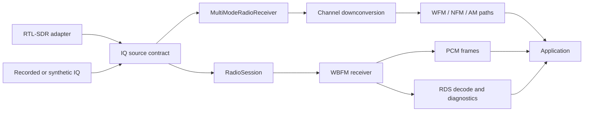

# libSDRForge architecture

libSDRForge owns IQ acquisition, signal processing and protocol decoding.
Applications assemble the pipeline and own presentation, audio routing,
USB permission prompts and reconnection policy.

| Area | Ownership |
| --- | --- |
| `interfaces/`, `models/` | Source and receiver contracts, typed IQ/PCM and receiver data. |
| `adapters/`, `simulation/` | Device access and injectable sources. Replay and synthetic inputs support offline checks. |
| `dsp/`, `receivers/` | Downconversion, demodulation, multiplex processing and receiver composition. |
| `session.py` | High-level WBFM acquisition and frame/status lifecycle. |
| `protocols/`, `telemetry/` | Receiver control, wire protocols and published observations. |
| `weather/`, `adsb/` | Domain-specific processing for NOAA weather and ADS-B. |

Use Hz for the mixed-mode channel and transport contracts. The WBFM quick-start
API in the [README](../README.md) accepts a center
frequency in MHz. Preserve sample rate and IQ format when replaying a recording.

## Design and interface guides

- [REST, rigctl and ZeroMQ](dual_transport_api.md)
- [NOAA auxiliary receiver contracts](noaa_auxiliary_receiver_contract.md)
- [NOAA RF and speech processing](noaa_rf_weather.md)
- [RDS and TMC discovery](rds_tmc_discovery.md)
- [OpenRoadCode extraction map](extraction-map.md)

Start with [examples](../examples/README.md) for usage, then use the
[component test guide](../component_test/README.md) to verify a target setup.
