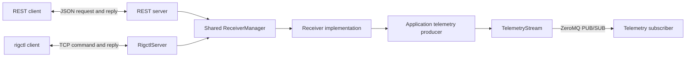

# Receiver control and telemetry

An application can attach REST and rigctl to the same receiver controller.
The application supplies observations to the ZeroMQ telemetry stream as
they become available. See [component tests](../component_test/README.md)
for a loopback setup using a synthetic receiver.



## REST receiver control

| Method and path | Contract |
| --- | --- |
| `GET /v1/health` | Returns `{"status":"ok"}` when the server is responding. |
| `GET /v1/receiver` | Current tuning, mode, bandwidth, lifecycle, signal measurements and RDS. Measurements can be null when unavailable. |
| `POST /v1/receiver/frequency` | JSON `frequency_hz` as a positive integer. |
| `POST /v1/receiver/mode` | JSON `mode` in FM, WFM, NFM or AM and nonnegative integer `bandwidth_hz`. |
| `POST /v1/receiver/start` | Starts the receiver. An async-capable controller returns HTTP 202. Read `/v1/receiver` for startup state. |
| `POST /v1/receiver/stop` | Stops the receiver. |

Successful synchronous commands return `{"ok":true}`. Invalid controls
return HTTP 400 and receiver failures typically return HTTP 503. The
[live server example](../examples/live_transport_server.py) also supports RF
configuration, audio and IQ capture workflows. The demo uses REST port 5570
and rigctl port 4532 on loopback.

## ZeroMQ telemetry

Install the `zmq` extra to enable publication. The demo publishes on
`tcp://127.0.0.1:5571`. Each message is one frame with an ASCII topic,
one space, and a UTF-8 JSON envelope:

```text
receiver {"schema_version":1,"payload":{...}}
```

- `receiver` carries a receiver snapshot with timestamp in nanoseconds,
  channel frequency and bandwidth in Hz, running state, and optional WFM
  stereo and RDS details.
- `spectrum` carries a spectrum snapshot, including center frequency and
  sample rate in Hz, bin geometry and an array of power values in dB.
- The stream publishes observations on a best-effort basis. Use REST or
  rigctl for acknowledged commands.

See the [snapshot builders](../src/sdrforge/telemetry/snapshots.py) for
field names and the [publisher](../src/sdrforge/protocols/zmq/publisher.py)
for the envelope implementation.
